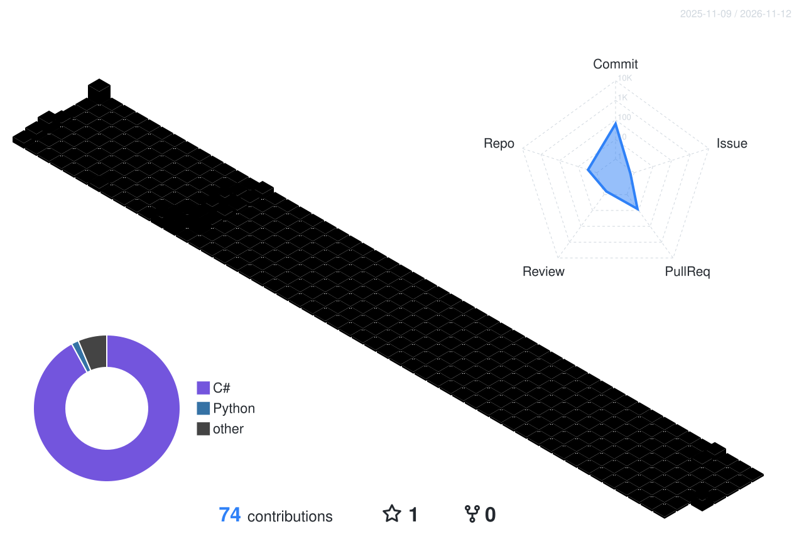

<!-- 头图：随 GitHub 主题自动切换，浅色/深色各一张 -->
<picture>
  <source media="(prefers-color-scheme: dark)"  srcset="./assets/header-dark.svg" />
  <source media="(prefers-color-scheme: light)" srcset="./assets/header.svg" />
  
</picture>

  <b>游戏程序</b> 
  <b>技术美术</b> 
  <b>幼儿园画手</b>

<!-- 3D 彩虹贡献图：由 .github/workflows/profile-3d.yml 每天生成两份，随主题切换 -->
<picture>
  <source media="(prefers-color-scheme: dark)"  srcset="./profile-3d-contrib/rainbow-night.svg" />
  <source media="(prefers-color-scheme: light)" srcset="./profile-3d-contrib/rainbow-day.svg" />
  
</picture>

